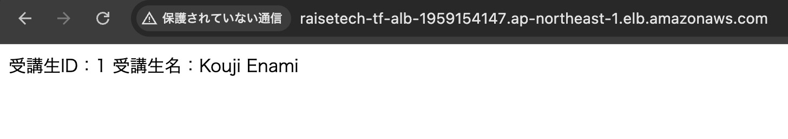
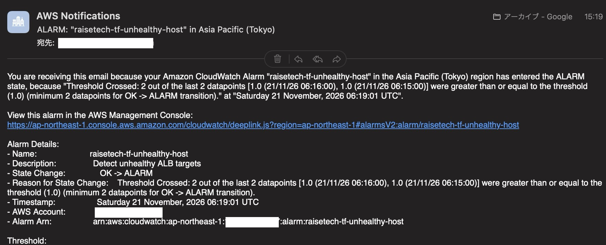
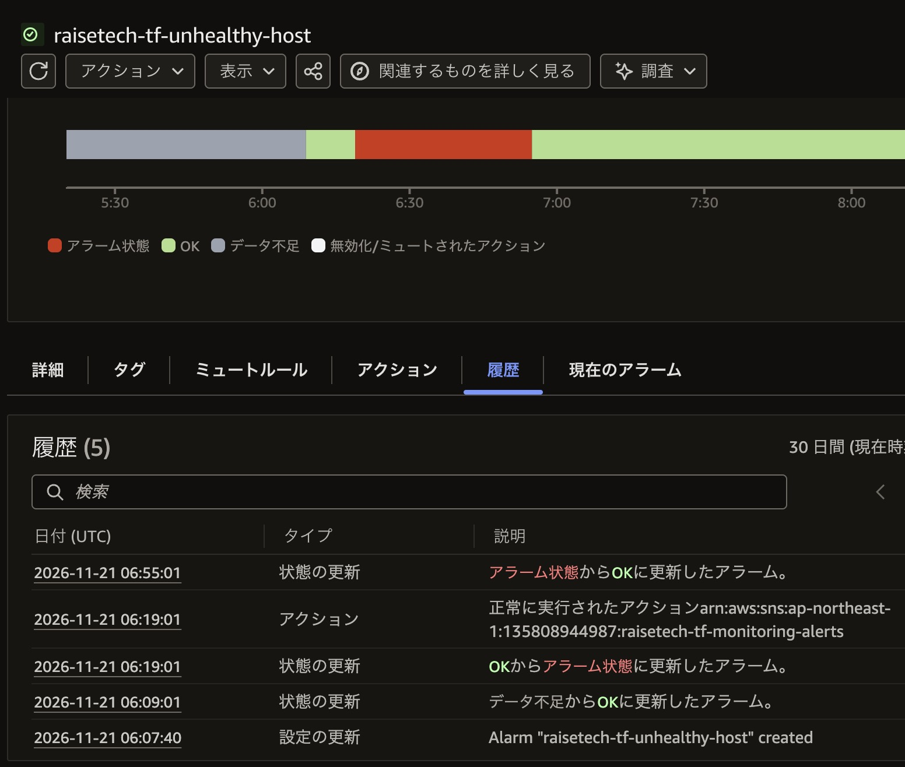
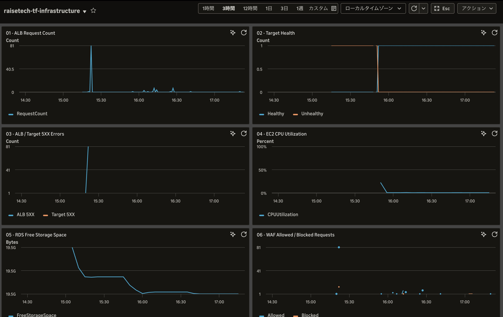

# Terraform 動作検証記録

## 1. 概要

RaiseTechのAWS課題でCloudFormationを使用して構築した環境をTerraformで再構築し、AWSリソースの作成、アプリケーションの動作、アクセス制御、ログ収集、監視・通知、構成差分、リソース削除について検証した記録です。

構築時にはEC2のUser Dataでエラーが発生しましたが、ログ調査によって原因を特定し、Terraformコードの修正とEC2の置換によって復旧しました。

本資料では、実際に実施した検証の手順と結果を記載します。障害調査の詳細については`troubleshooting.md`に整理します。

### 検証環境

| 項目 | 内容 |
|---|---|
| 検証日 | 2026年11月21日 |
| IaC | Terraform |
| AWSリージョン | ap-northeast-1（東京） |
| OS | Amazon Linux 2023 |
| アプリケーション | Spring Boot / Java 21 |
| DB | RDS for MySQL |
| 実装構成 | 7モジュール |
| Terraform管理リソース数 | 54 |
| State管理 | S3 Backend |
| Stateロック | S3ネイティブロック（`use_lockfile`） |

AWS CLIおよびTerraformのコマンドは、基本的に`terraform/environments/dev`ディレクトリから実行しています。

コマンドの実行結果は主要部分を抜粋しており、AWSアカウントID、グローバルIPアドレスなどの識別情報は省略またはマスキングしています。

## 2. 検証項目一覧

| No. | 検証項目 | 結果 |
|---|---|---|
| 1 | Terraform初回Plan | 成功 |
| 2 | Terraform初回Apply | 成功 |
| 3 | EC2 User DataとSpring Bootの起動 | 修正後成功 |
| 4 | Spring BootからRDSへの接続・データ取得 | 成功 |
| 5 | ALB Target Groupのヘルスチェック | Healthy |
| 6 | ALB経由のHTTPアクセス | HTTP 200 |
| 7 | WAFカスタムルールによる遮断 | HTTP 403 |
| 8 | WAFの遮断条件に一致しないリクエスト | HTTP 200 |
| 9 | WAFログの収集 | 成功 |
| 10 | Spring Bootログの収集 | 成功 |
| 11 | RDSエラーログの収集 | 成功 |
| 12 | ALBアクセスログの収集 | 確認済み |
| 13 | CloudWatch Alarmの状態確認 | 5種類すべてOK |
| 14 | SNSメール購読・通知 | 成功 |
| 15 | CloudWatch Alarmの異常検知・復旧 | 成功 |
| 16 | CloudWatch Dashboard | 6ウィジェット確認 |
| 17 | Terraformコード修正・部分的な置換 | 成功 |
| 18 | Terraform最終差分確認 | No changes |
| 19 | Terraform Stateの管理対象確認 | 54リソース |
| 20 | Terraform Destroy | 54リソース削除成功 |
| 21 | AWS残存リソース確認 | 確認済み |

## 3. TerraformによるAWS環境構築

### 3.1 検証目的

Terraformで定義したAWSリソースが意図した構成で作成されることを確認する。

### 3.2 Plan

**実行コマンド**

```bash
terraform plan -out=dev.tfplan
```

**実行結果**

```text
Plan: 54 to add, 0 to change, 0 to destroy.
```

保存したPlanの内容を確認しました。

```bash
terraform show dev.tfplan
```

**判定：成功**

54リソースの新規作成が計画され、既存リソースの変更・削除はありませんでした。

### 3.3 Apply

**実行コマンド**

```bash
terraform apply dev.tfplan
```

**実行結果**

```text
Apply complete! Resources: 54 added, 0 changed, 0 destroyed.
```

**判定：成功**

54リソースの作成が完了しました。

ただし、初回Apply後はEC2のUser Dataでエラーが発生しており、アプリケーションの動作検証は失敗しました。原因と復旧については第4章に記載します。

## 4. User Dataの障害調査と復旧

### 4.1 初回構築時の障害

ALB経由でSpring Bootにアクセスしたところ、次のレスポンスが返りました。

```text
HTTP/1.1 502 Bad Gateway
Server: awselb/2.0
```

CloudWatch AlarmでもUnHealthyHostCountの異常が検知され、SNSによるメール通知を受信しました。

### 4.2 EC2の状態確認

**実行コマンド**

```bash
sudo cloud-init status --long
```

**実行結果**

```text
status: error

detail:
('scripts-user', RuntimeError(
  'Runparts: 1 failures (part-001) in 1 attempted commands'
))
```

User Dataの実行に失敗していることを確認しました。

次に、cloud-initのログを確認しました。

```bash
sudo tail -n 100 /var/log/cloud-init-output.log
```

**確認できたエラー**

```text
package curl-minimal-... from @System
conflicts with curl provided by curl-...
```

Amazon Linux 2023にインストールされている`curl-minimal`と、User Dataで追加指定した`curl`パッケージが競合していました。

### 4.3 アプリケーション起動状態の確認

**実行コマンド**

```bash
sudo systemctl status raisetech-app --no-pager -l
```

**実行結果**

```text
Unit raisetech-app.service could not be found.
```

続いて、8080番ポートの状態を確認しました。

```bash
sudo ss -tlnp | grep ':8080'
```

待ち受けは確認できませんでした。

EC2自身からのHTTPアクセスも失敗しました。

```bash
curl -i --max-time 5 http://127.0.0.1:8080/
```

```text
curl: (7) Failed to connect to 127.0.0.1:8080
```

パッケージインストールの失敗によってUser Dataが途中終了し、Spring Bootのセットアップ・起動処理まで実行されていないことがわかりました。

### 4.4 Terraformコード修正

User Dataのパッケージインストール対象から、不要な`curl`を削除しました。

EC2リソースには次の設定を使用しています。

```hcl
user_data_replace_on_change = true
```

User Dataの変更によってEC2が置換される構成です。

**修正後のPlan**

```text
Plan: 2 to add, 2 to change, 2 to destroy.
```

**変更対象**

| リソース | 操作 |
|---|---|
| EC2 | 置換 |
| Target Group Attachment | 置換 |
| EC2 CPU Alarm | 更新 |
| CloudWatch Dashboard | 更新 |

関連するリソースの変更内容を確認してから、保存済みPlanをApplyしました。

### 4.5 再構築後の確認

**cloud-init**

```bash
sudo cloud-init status --wait
sudo cloud-init status --long
```

**実行結果**

```text
status: done

detail:
DataSourceEc2
```

**systemd**

```bash
sudo systemctl status raisetech-app --no-pager -l
```

**実行結果（抜粋）**

```text
Loaded: loaded (...; enabled; preset: disabled)
Active: active (running)
Main PID: 27221 (java)

Tomcat started on port 8080 (http)
Started DemoApplication in 4.677 seconds
```

**ポートの確認**

```bash
sudo ss -tlnp | grep ':8080'
```

**実行結果（抜粋）**

```text
LISTEN ... *:8080 ... users:(("java",pid=27221,...))
```

**ローカルHTTP通信**

```bash
curl -i --max-time 5 http://127.0.0.1:8080/
```

**実行結果**

```text
HTTP/1.1 200
Content-Type: text/plain;charset=UTF-8

受講生ID：1
受講生名：Kouji Enami
```

**判定：成功**

User Dataが正常終了し、Spring Bootの起動とローカルHTTP通信が正常に動作することを確認しました。

## 5. Spring BootとRDSの接続検証

### 5.1 検証目的

EC2上のSpring BootからRDS MySQLへ接続し、データを取得できることを確認する。

### 5.2 アプリケーションログの確認

**実行コマンド**

```bash
sudo systemctl status raisetech-app --no-pager -l
```

**確認できたログ**

```text
HikariPool-1 - Starting...
HikariPool-1 - Added connection ...
HikariPool-1 - Start completed.
```

さらに、アプリケーションのルートパスへアクセスすると、RDSから取得した受講生情報が表示されました。

```text
受講生ID：1
受講生名：Kouji Enami
```

**判定：成功**

Spring BootとRDS間の接続、およびデータ取得が成功しました。

## 6. ALBの動作検証

### 6.1 Target Groupのヘルスチェック

**実行コマンド**

```bash
TG_ARN=$(aws elbv2 describe-target-groups \
  --names raisetech-tf-alb-tg \
  --region ap-northeast-1 \
  --query 'TargetGroups[0].TargetGroupArn' \
  --output text)

aws elbv2 describe-target-health \
  --target-group-arn "$TG_ARN" \
  --region ap-northeast-1 \
  --query 'TargetHealthDescriptions[].{Instance:Target.Id,Port:Target.Port,State:TargetHealth.State,Reason:TargetHealth.Reason}' \
  --output table
```

**実行結果（抜粋）**

```text
Instance             Port   Reason   State
i-09d1753b314fb3781 8080   None     healthy
```

**判定：成功**

ALBがEC2を正常な転送先として認識していることを確認しました。

### 6.2 ALB経由のHTTPアクセス

**実行コマンド**

```bash
ALB_DNS=$(terraform output -raw alb_dns_name)

curl -i --max-time 10 "http://$ALB_DNS/"
```

**実行結果**

```text
HTTP/1.1 200
Content-Type: text/plain;charset=UTF-8

受講生ID：1
受講生名：Kouji Enami
```

**判定：成功**

ALB経由のHTTPアクセスに成功し、Spring BootからRDSのデータを取得できました。

ブラウザからのアクセスについても確認しました。


## 7. AWS WAFの動作検証

### 7.1 検証目的

WAFのカスタムルールで指定したHTTPヘッダーによって、リクエストが意図どおりに遮断されることを確認する。

### 7.2 カスタムルール

| 項目 | 設定 |
|---|---|
| Rule | BlockTestHeader |
| Priority | 0 |
| HTTP Header | x-raisetech-test |
| Search String | block-me |
| Match | EXACTLY |
| Action | BLOCK |

### 7.3 通常のアクセス

```bash
curl -i --max-time 10 "http://$ALB_DNS/"
```

**結果：HTTP 200**

### 7.4 遮断対象ヘッダー

**実行コマンド**

```bash
curl -i --max-time 10 \
  -H "x-raisetech-test: block-me" \
  "http://$ALB_DNS/"
```

**実行結果**

```text
HTTP/1.1 403 Forbidden
Server: awselb/2.0
```

**判定：成功**

指定したヘッダーに対する遮断を確認しました。

### 7.5 一致しないヘッダー

**実行コマンド**

```bash
curl -i --max-time 10 \
  -H "x-raisetech-test: allow-me" \
  "http://$ALB_DNS/"
```

**実行結果**

```text
HTTP/1.1 200

受講生ID：1
受講生名：Kouji Enami
```

**判定：成功**

カスタムルールの遮断条件に一致しないリクエストで、正常なHTTP応答を確認しました。

なお、AWSマネージドルールについては設定を確認していますが、個別の検出・遮断テストは実施していません。

## 8. WAFログの検証

### 8.1 検証目的

WAFによって遮断したリクエストがCloudWatch Logsへ記録されることを確認する。

### 8.2 ログの取得

**実行コマンド**

```bash
aws logs tail aws-waf-logs-raisetech-tf \
  --since 15m \
  --region ap-northeast-1 \
  --filter-pattern '{ $.action = "BLOCK" }' \
  --format short
```

**実行結果（主要部分）**

```json
{
  "terminatingRuleId": "BlockTestHeader",
  "terminatingRuleType": "REGULAR",
  "action": "BLOCK",
  "httpSourceName": "ALB",
  "httpRequest": {
    "country": "JP",
    "uri": "/",
    "args": "REDACTED",
    "httpMethod": "GET",
    "scheme": "http"
  }
}
```

実際のログには、遮断対象の`x-raisetech-test: block-me`ヘッダーも含まれていました。

**判定：成功**

WAFのカスタムルールによるBLOCKが記録されていることを確認しました。

また、クエリ文字列が`REDACTED`になっていることも確認しました。

## 9. Spring Bootログの検証

### 9.1 検証目的

EC2上のSpring Bootのログが、CloudWatch Agentを通じてCloudWatch Logsへ送信されることを確認する。

### 9.2 Log Streamの確認

**実行コマンド**

```bash
aws logs describe-log-streams \
  --log-group-name /raisetech/terraform/application \
  --region ap-northeast-1 \
  --query 'logStreams[].{Stream:logStreamName,LastEvent:lastEventTimestamp}' \
  --output table
```

**実行結果（抜粋）**

```text
Stream
i-09d1753b314fb3781
```

置換後のEC2インスタンスIDと一致するLog Streamが作成されていました。

### 9.3 ログの取得

**実行コマンド**

```bash
aws logs tail /raisetech/terraform/application \
  --since 1h \
  --region ap-northeast-1 \
  --format short
```

**確認できたログ**

```text
Started raisetech-app.service
Tomcat started on port 8080 (http)
Started DemoApplication in 4.677 seconds
HikariPool-1 - Start completed.
```

ログはjournaldのフィールドを含むJSON形式で記録されていました。

主なフィールド：

- `body.MESSAGE`
- `body.PRIORITY`
- `body.SYSLOG_IDENTIFIER`
- `body._COMM`
- `body._PID`
- `body._SYSTEMD_UNIT`
- `body._TRANSPORT`

**判定：成功**

systemdとSpring BootのログがCloudWatch Logsに転送されていることを確認しました。

## 10. RDSエラーログの検証

### 10.1 RDSの状態とログエクスポート設定

**実行コマンド**

```bash
aws rds describe-db-instances \
  --db-instance-identifier raisetech-tf-rds \
  --region ap-northeast-1 \
  --query 'DBInstances[0].{Status:DBInstanceStatus,LogExports:EnabledCloudwatchLogsExports}' \
  --output json
```

**実行結果**

```json
{
  "Status": "available",
  "LogExports": [
    "error"
  ]
}
```

### 10.2 Log Streamの確認

**実行コマンド**

```bash
aws logs describe-log-streams \
  --log-group-name /aws/rds/instance/raisetech-tf-rds/error \
  --region ap-northeast-1 \
  --query 'logStreams[].logStreamName' \
  --output text
```

**確認結果**

```text
raisetech-tf-rds
```

### 10.3 ログの取得

**実行コマンド**

```bash
aws logs tail /aws/rds/instance/raisetech-tf-rds/error \
  --since 3h \
  --region ap-northeast-1 \
  --format short
```

**確認できたログ（抜粋）**

```text
[System] MySQL Server - start.
[System] InnoDB initialization has started.
[System] InnoDB initialization has ended.
[System] mysqld: ready for connections.
```

MySQL 8.4.11の起動ログを確認しました。

Warningも一部記録されていましたが、Spring Bootからの接続とデータ取得は成功しています。

**判定：成功**

RDSエラーログのCloudWatch Logsへのエクスポートを確認しました。

## 11. ALBアクセスログの検証

### 11.1 検証目的

ALBアクセスログがS3バケットへ保存されることを確認する。

### 11.2 バケットとログオブジェクトの確認

**実行コマンド**

```bash
BUCKET=$(terraform output -raw alb_logs_bucket_name)

aws s3 ls "s3://$BUCKET/alb/" --recursive
```

アクセスログ用S3バケットにログオブジェクトが保存されていることを確認しました。

ALBアクセスログは`alb/AWSLogs/`以下に保存する設定とし、S3 Lifecycleによる14日間の保持期間を設定しています。

**判定：確認済み**

ログオブジェクトの存在と保存内容を確認していますが、CLI出力の全文は本資料に掲載していません。

## 12. CloudWatch Alarmの検証

### 12.1 全アラームの状態確認

**実行コマンド**

```bash
aws cloudwatch describe-alarms \
  --alarm-name-prefix raisetech-tf- \
  --region ap-northeast-1 \
  --query 'MetricAlarms[].{Name:AlarmName,State:StateValue,ActionsEnabled:ActionsEnabled}' \
  --output table
```

**実行結果**

| Alarm | State | ActionsEnabled |
|---|---|---|
| raisetech-tf-alb-5xx | OK | True |
| raisetech-tf-ec2-high-cpu | OK | True |
| raisetech-tf-rds-high-storage | OK | True |
| raisetech-tf-target-5xx | OK | True |
| raisetech-tf-unhealthy-host | OK | True |

**判定：成功**

5種類すべてのAlarmがOK状態であり、アクションも有効であることを確認しました。

ただし、ALB 5XX、Target 5XX、EC2 CPU、RDSストレージ使用率については、各閾値を意図的に超過させる個別テストは実施していません。

### 12.2 SNSメール購読

**実行コマンド**

```bash
aws sns list-subscriptions-by-topic \
  --topic-arn "$(terraform output -raw alarm_topic_arn)" \
  --region ap-northeast-1 \
  --query 'Subscriptions[].{Protocol:Protocol,SubscriptionArn:SubscriptionArn}' \
  --output table
```

**確認結果**

```text
Protocol: email
SubscriptionArn: arn:aws:sns:...:subscription-id
```

SubscriptionArnが`PendingConfirmation`ではなく正式なARNになっていることを確認しました。

**判定：成功**

メール購読が承認され、実際に異常検知メールも受信しました。


### 12.3 UnHealthyHostCountの状態遷移

**実行コマンド**

```bash
aws cloudwatch describe-alarm-history \
  --alarm-name raisetech-tf-unhealthy-host \
  --history-item-type StateUpdate \
  --region ap-northeast-1 \
  --query 'AlarmHistoryItems[].{Time:Timestamp,Summary:HistorySummary}' \
  --output table
```

**実行結果**

| 時刻（JST） | 状態遷移 |
|---|---|
| 2026-11-21 15:09 | INSUFFICIENT_DATA → OK |
| 2026-11-21 15:19 | OK → ALARM |
| 2026-11-21 15:55 | ALARM → OK |

**判定：成功**

初回のUser Data失敗によるターゲット異常がCloudWatch Alarmで検知され、SNSメール通知が行われました。

その後、TerraformによるEC2置換とアプリケーションの復旧により、AlarmがOK状態へ戻ったことを確認しました。

ALARM状態の継続時間は約36分です。これはCloudWatch Alarmの状態遷移に基づく時間であり、サービスの正確な停止時間とは異なります。


## 13. CloudWatch Dashboardの検証

### 13.1 Dashboardの存在確認

**実行コマンド**

```bash
aws cloudwatch list-dashboards \
  --dashboard-name-prefix raisetech-tf- \
  --region ap-northeast-1 \
  --output table
```

**確認結果**

```text
DashboardName: raisetech-tf-infrastructure
```

### 13.2 Dashboard設定の取得

**実行コマンド**

```bash
aws cloudwatch get-dashboard \
  --dashboard-name "$(terraform output -raw dashboard_name)" \
  --region ap-northeast-1 \
  --query 'DashboardBody' \
  --output text | jq .
```

**設定を確認したウィジェット**

1. ALB Request Count
2. Target Health
3. ALB / Target 5XX Errors
4. EC2 CPU Utilization
5. RDS Free Storage Space
6. WAF Allowed / Blocked Requests

EC2 CPUのメトリクスでは、EC2置換後のインスタンスIDが反映されていることを確認しました。

マネジメントコンソールでもDashboardの表示を確認しました。


**判定：成功**

6種類のウィジェットがTerraformの定義に沿って作成されていることを確認しました。

## 14. Terraformの構成差分確認

### 14.1 検証目的

Terraformで管理している構成と、実際のAWSリソースの状態に意図しない差分がないことを確認する。

### 14.2 Plan

**実行コマンド**

```bash
terraform plan
```

**実行結果**

```text
No changes. Your infrastructure matches the configuration.

Terraform has compared your real infrastructure
against your configuration and found no differences,
so no changes are needed.
```

**判定：成功**

構築・修正・動作検証を完了した時点で、Terraformの定義とAWS環境に変更を必要とする差分がないことを確認しました。

### 14.3 Stateの管理対象確認

**実行コマンド**

```bash
terraform state list
```

管理対象のリソースとデータソースの一覧を取得しました。

データソースを除外して数を確認しました。

```bash
terraform state list | grep -vE '(^|\.)data\.' | wc -l
```

**実行結果**

```text
54
```

**判定：成功**

Terraform Stateに54リソースが管理対象として記録されていることを確認しました。

## 15. Terraform Destroyの検証

### 15.1 検証目的

Terraformが管理するリソースを一括削除し、不要なAWSリソースが残らないことを確認する。

### 15.2 Destroy前の確認

**実行コマンド**

```bash
terraform plan -destroy
```

**実行結果**

```text
Plan: 0 to add, 0 to change, 54 to destroy.
```

削除対象が今回のTerraform管理リソースであることを確認しました。

### 15.3 ALBアクセスログ用S3の削除準備

ALBアクセスログの配信を停止し、保存されていたログオブジェクトを削除しました。

アクセスログ用S3バケットはTerraform管理対象であるため、バケット本体の削除はTerraformへ任せています。

Backend用S3バケットは今回のDestroy対象ではなく、削除していません。

### 15.4 Destroy実行

**実行コマンド**

```bash
terraform plan -destroy -out=destroy.tfplan

terraform show destroy.tfplan

terraform apply destroy.tfplan
```

**実行結果**

```text
Apply complete! Resources: 0 added, 0 changed, 54 destroyed.
```

**判定：成功**

Terraformによる54リソースの削除が完了しました。

### 15.5 残存リソース確認

Destroy後にAWS上の残存リソースを確認し、今回のTerraform構築で使用したリソースが削除されていることを確認しました。

State管理用の共有S3 Backendは保持しています。

RDSは最終スナップショットを取得しない構成のため、検証環境内のDBデータも削除対象としました。

## 16. 未実施の検証・今後の課題

今回の動作検証では主要機能の正常性を確認しましたが、次の項目は未実施です。

| 項目 | 今後の検証内容 |
|---|---|
| AWS WAFマネージドルール | 個別ルールの検出・遮断動作を検証 |
| ALB 5XX Alarm | 閾値超過時の状態遷移と通知を検証 |
| Target 5XX Alarm | アプリケーション側の5XX検出を検証 |
| EC2 CPU Alarm | CPU使用率70%以上での通知を検証 |
| RDS Storage Alarm | 使用率80%以上での通知を検証 |
| EC2再起動後の動作 | systemdによる自動復旧を別途検証 |
| セキュリティ異常系 | 許可されていない通信の拒否を個別に検証 |
| Terraform CI | fmt・validateなどの自動実行を導入 |
| 継続的な監視 | 長時間稼働時の安定性を確認 |

## 17. 総合結果

Terraformを使用してCloudFormation版のAWS環境を再構築し、以下を確認しました。

- 54リソースの構築と削除
- Terraform Module間のOutputs・変数による連携
- S3 BackendによるState管理
- EC2 User Dataによる自動セットアップ
- Spring BootとRDSの接続・データ取得
- ALBによるHTTP通信とヘルスチェック
- WAFによるアクセス制御
- 4種類のログ収集
- CloudWatch AlarmとSNSによる異常検知・通知
- CloudWatch Dashboardによる監視
- 障害発生時のログ調査、Terraformコード修正、EC2置換、復旧
- 最終Planによる構成差分なしの確認
- Destroyによる環境削除と残存リソース確認

今回の検証では、Terraformによるインフラの構築だけでなく、障害調査からコード修正、再構築、復旧確認、削除までの一連の操作を実施しました。

これにより、Terraformの基本的なリソース管理と、AWS上での構築・検証・障害対応の流れを学習しました。

---

関連資料：

- [Terraform README](../README.md)
- [障害調査・復旧記録](troubleshooting.md)
